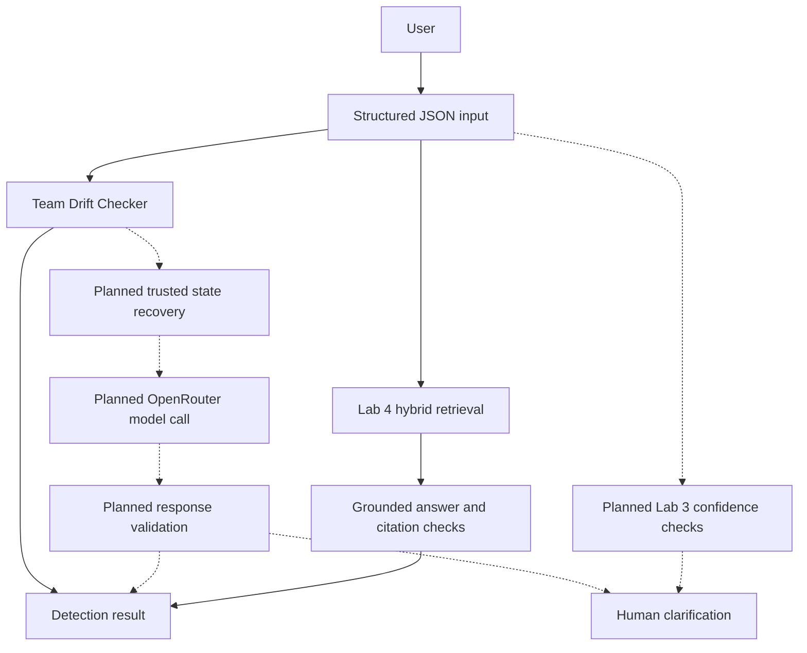

# Design Review - Blue Whale

Team: Blue Whale
Repository: https://github.com/anaBalukha/Blue_Whale

Members:
- Ana Balukhashvili (@anaBalukha)
- Mikheili Kakhniashvili (@mishakakhniashvili)
- Aleksandre Giorgashvili (@lexokodavs)

Graded tag: design-review (not yet created)

## 1 · Problem, users, success criteria (2 points)

**Problem.** AI assistants can lose track of decisions and requirements
during long conversations. This can cause incorrect suggestions,
contradictions, and wasted work. Users currently have to notice these
mistakes and remind the assistant of earlier decisions manually.

**Users.** University students and software developers working on
multi-step projects with AI assistants.

Full product specification: [docs/spec.md](spec.md).

| # | Success criterion | Measured by | Today |
|---|---|---|---|
| S1 | At least 85% drift detection accuracy on 50 or more labeled cases | Offline classification benchmark | Not yet evaluated |
| S2 | At least 80% successful recovery of confirmed drift cases | Recovery evaluation | Not yet implemented |
| S3 | At least 90% consistency in the next response after recovery | Follow-up consistency tests | Not yet implemented |

**Current evidence.** An individual HW1 prototype implements
structured decision comparison and explicit user overrides.
It passed 4 automated tests and 3 manually executed golden cases.
The shared drift checker is now integrated in src/drift_core.py (PR #8).

Prototype: [Ana's HW1](../hw1/anaBalukha/).

## 2 · Architecture and data flow (2 points)

Blue Whale is planned as a terminal application for conversation
drift detection and recovery. The shared team
[drift checker](../src/drift_core.py) and Lab 4 retrieval are implemented.

Solid arrows show the existing prototype workflow.
Dashed arrows represent planned components, not working code.

| Model call | Input | Output | Status |
|---|---|---|---|
| Recovery | Trusted state and AI response | Corrected answer | Planned |
| Grounded answer | Retrieved documents | Cited answer or refusal | Implemented; offline-tested |

No live LLM calls or token usage logs are available yet.

## 3 · Risks and safety threats (2 points)

| Risk | User impact | Mitigation | Proposed owner |
|---|---|---|---|
| Outdated conversation state | AI follows an old decision | Explicit user changes override stored decisions; structured comparison exists in [HW1](../hw1/anaBalukha/src/drift_checker.py) | Ana |
| False drift detection | Valid AI response gets rejected | Expand labeled tests, including intentional user changes; planned Week 5 | Mikheili |
| Private data exposure | Sensitive conversation information is revealed | Keep minimum required state in memory; never commit keys or real conversations | Ana |
| Ungrounded AI answers | AI invents facts or citations | Citation validation and refusal implemented in src/answer.py; offline tests pass | Mikheili |
| Low-confidence or failed recovery | User receives an unreliable correction | Implement Lab 3 confidence handling and request human clarification; planned Week 5 | Ana |
| Model outage or unexpected cost | Recovery fails or costs increase | Add error handling, usage logs and a spending limit; planned Week 5 | Ana |

**Current limitations:** Lab 3 PR #13 is pending. Lab 4 is implemented, but full live-model evaluation is missing. The owners
above are proposed assignments pending team confirmation.

## 4 · Evaluation plan (2 points)

### Current evidence

[Ana's individual HW1](../hw1/anaBalukha/golden.md)
has three executed golden cases:

| Case | Result |
|---|---|
| Detect conflicting decisions | PASS |
| Accept explicit user changes | PASS |
| Reject invalid input | PASS |

Result: 3/3 golden cases passed (100%).
The four automated pytest tests also passed.

These results verify the individual structured drift checker,
not the complete team application or Lab 4 RAG system.

### Team Lab 4 evaluation evidence

The team implemented hybrid retrieval, grounded answers,
citation verification, and refusal handling in `src/`.
The implementation was merged through PR #9.

The five-case golden set is committed at
[evals/golden.yaml](../evals/golden.yaml).

[Offline evaluation results](../evals/results/2026-10-20-0251-offline-k3.json):
**4/5 passed (80%)** against the 0.70 pass threshold.

- Two factual cases: passed.
- One reasoning case (g3): failed because the required
  two-document evidence was not cited.
- One edge case: passed.
- One refusal case: passed.

Offline mode uses simulated embeddings and answers.
These results do not demonstrate real-model answer quality.
A complete live-model golden run has not been recorded.

### Planned evaluation

Before the Design Review, create and execute a team golden set
including a case that requires refusal.

By Week 11, expand to 10 questions:
- 3 factual
- 2 reasoning
- 2 edge cases
- 2 refusal cases
- 1 output-format case

An evaluation score below 0.70 should block promotion
of a new application version.

## 5 · Token budget (1 point)

### Current measurements

The individual HW1 drift checker uses deterministic Python
comparisons and requires zero LLM tokens.

The team application has no recorded real model calls.
Therefore, median tokens, cost, and latency from 10 real
requests cannot yet be reported.

### Estimated model cost (not measured)

Planning assumptions from [spec.md](spec.md):
- 300 requests per day, 30 days per month.
- 2,000 input tokens and 500 output tokens per request.
- Assumed prices: $0.75/M input and $3.75/M output tokens.

Estimated monthly cost:
300 * 30 * (2000 * 0.75 + 500 * 3.75) / 1000000
= $30.38, excluding extra recovery calls.

Model availability and pricing must be verified.

### RAG versus long context

Illustrative comparison:
- Full context: 10,000 input tokens.
- Retrieved context: 2,000 input tokens.
- Difference: 8,000 input tokens per request.

At the assumed input price, this saves $0.006 per
request before embedding and retrieval costs.

Actual measurements are required before choosing
the final retrieval strategy.

## 6 · Team, roles and decisions (1 point)

### Team responsibilities

| Member | GitHub | Primary role | Backup role |
|---|---|---|---|
| Ana Balukhashvili | @anaBalukha | Repo keeper | Eval keeper |
| Aleksandre Giorgashvili | @lexokodavs | Spec keeper | Repo keeper |
| Mikheili Kakhniashvili | @mishakakhniashvili | Eval keeper | Spec keeper |

Responsibilities are recorded in [TEAM-REPO.md](TEAM-REPO.md).

### Team contract

The [team contract](../TEAM-CONTRACT.md) documents roles,
majority voting, asynchronous Messenger coordination,
contributions, and conflict resolution.

All three members must still approve and sign the contract.

### Decision records

1. [ADR 001: Terminal-first MVP](decisions/001-terminal-first.md)
   - Start with a command-line interface to simplify testing.
2. [ADR 002: Explicit user changes](decisions/002-explicit-user-changes.md)
   - New explicit user decisions override conflicting older state.

Both decisions are also reflected in [spec.md](spec.md).

### Remaining implementation evidence

- Merge the Lab 3 multimodal feature (PR #13).
- Run the full golden set with real models.
- Record at least ten real model calls and their usage.
- Integrate and test trusted-state recovery.
- Obtain all three team members' genuine contract approval.
